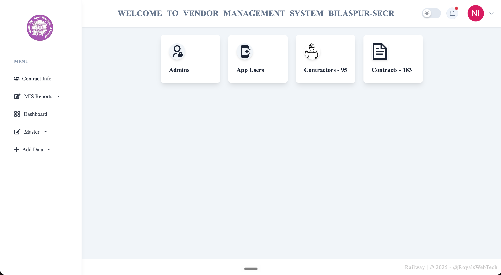

<p align="center">
  
</p>

# Vendor Management System — Bilaspur SECR

[](https://github.com/pawanannepu/bspdsecrvms/actions/workflows/ci.yml)
[](https://github.com/pawanannepu/bspdsecrvms/actions/workflows/cd.yml)


Web app for managing vendors, contractors, contracts, and MIS reports for **Bilaspur — South East Central Railway (SECR)**.

[Overview](#overview) · [Features](#features) · [Getting started](#getting-started) · [Run the app](#run-the-app) · [Deploy](#deploy) · [Routes](#routes) · [Troubleshooting](#troubleshooting)

<p align="center">
  
</p>

## Overview

**bspdsecrvms** is a single deployable [Next.js](https://nextjs.org) App Router application that mirrors the operational UI used by Bilaspur SECR for vendor management.

It includes authenticated access, master data screens (admins, app users, contractors, contracts), Add Data forms, MIS report views, and a profile page. Persistence uses SQLite locally (or Docker) and [Turso](https://turso.tech) (hosted libSQL) on serverless hosts such as Vercel.

| Layer | Choice |
| --- | --- |
| UI | Next.js 16, React 19, Tailwind CSS 4 |
| Auth | [Better Auth](https://www.better-auth.com) (email / password) |
| Data | Drizzle ORM + `@libsql/client` |
| Local DB | SQLite file under `data/` |
| Cloud DB | Turso / libSQL |
| CI/CD | GitHub Actions → lint, typecheck, build + GHCR Docker image |

## Features

- Email/password login with session cookies and route protection
- Dashboard cards for Admins, App Users, Contractors, and Contracts
- Master tables with edit/delete action affordances
- Add Data flows for admin, app user, contractor, contract, and vendor
- MIS report screens (vendors, approval status, contracts, location/section, station vendors)
- Dark/light theme toggle and in-app notifications bell
- Cached list queries + partial prefetch for faster navigations
- Docker Compose and Vercel-ready configuration

## Getting started

### Prerequisites

- [Node.js](https://nodejs.org/) 22+
- npm 10+
- [Git](https://git-scm.com/)
- Optional: [Docker](https://www.docker.com/) for container runs
- Optional: [Turso CLI](https://docs.turso.tech/cli) for hosted SQLite (required for Vercel)

### Install

```bash
git clone https://github.com/pawanannepu/bspdsecrvms.git
cd bspdsecrvms
npm install
cp .env.example .env
```

Generate a secret and put it in `.env`:

```bash
openssl rand -base64 32
```

| Variable | Required | Notes |
| --- | --- | --- |
| `BETTER_AUTH_SECRET` | Yes | Min 32 characters |
| `BETTER_AUTH_URL` | Yes | App origin, no trailing slash (e.g. `http://localhost:3000`) |
| `NEXT_PUBLIC_APP_URL` | Yes | Same origin as above |
| `DATABASE_FILE` | Local/Docker | Default `vms.db` → `data/vms.db` |
| `TURSO_DATABASE_URL` | Vercel | `libsql://…` — when set, file DB is ignored |
| `TURSO_AUTH_TOKEN` | Vercel | Turso DB token |

## Run the app

### Local development (SQLite file)

```bash
npm run db:seed
npm run dev
```

Open [http://localhost:3000](http://localhost:3000).

> [!NOTE]
> Seed creates tables and demo records. Default login:
>
> - **Email:** `adminbilaspur@gmail.com`
> - **Password:** `123`

### Scripts

| Command | Purpose |
| --- | --- |
| `npm run dev` | Dev server |
| `npm run build` | Production build |
| `npm start` | Serve production build |
| `npm run lint` | ESLint |
| `npm run typecheck` | TypeScript (`tsc --noEmit`) |
| `npm run db:seed` | Create schema + seed demo user/data |
| `npm run db:push` | Push Drizzle schema |

### Docker

```bash
cp .env.example .env
# set BETTER_AUTH_SECRET, BETTER_AUTH_URL, NEXT_PUBLIC_APP_URL

docker compose up -d --build
```

SQLite is stored in the `vms-data` volume (`/app/data`). Seed against the same DB configuration when needed:

```bash
npm run db:seed
```

## Deploy

### Vercel + Turso

Local SQLite does **not** persist on Vercel. Use Turso near your users (e.g. Mumbai `aws-ap-south-1`).

```bash
# Install CLI: https://docs.turso.tech/cli
turso auth login
turso db locations

# Prefer a nearby primary region via a group
turso group create india --location aws-ap-south-1 -w
turso db create bspdsecrvms-in --group india -w

turso db show bspdsecrvms-in --url
turso db tokens create bspdsecrvms-in
```

Set these in the Vercel project (Production), **without** trailing slashes on URLs:

- `BETTER_AUTH_SECRET`
- `BETTER_AUTH_URL` → `https://your-app.vercel.app`
- `NEXT_PUBLIC_APP_URL` → `https://your-app.vercel.app`
- `TURSO_DATABASE_URL`
- `TURSO_AUTH_TOKEN`

Seed the remote DB from your machine:

```bash
TURSO_DATABASE_URL=libsql://… TURSO_AUTH_TOKEN=… npm run db:seed
```

This repo includes `vercel.json` with `regions: ["bom1"]` so serverless functions run in Mumbai when available.

> [!TIP]
> After rotating Turso credentials or moving regions, update Vercel env vars and redeploy. Re-run `db:seed` on the new database.

### GitHub Container Registry

CD builds and pushes on pushes to `main`, version tags, or manual dispatch:

```bash
docker pull ghcr.io/pawanannepu/bspdsecrvms:latest
```

CI runs lint, typecheck, and build on every push/PR to `main`.

## Routes

| Route | Screen |
| --- | --- |
| `/login` | Sign in |
| `/` | Dashboard |
| `/admins` | Admins |
| `/app-users` | App users |
| `/contractors` | Contractors |
| `/contracts` | Contracts |
| `/add/admin` … `/add/vendor` | Create forms |
| `/mis/*` | MIS reports |
| `/profile` | Profile details |

Design references live under [`assets/`](assets/).

## Project layout

```text
src/
  app/                 # App Router pages + API routes
  components/          # Header, sidebar, forms, tables
  lib/auth.ts          # Better Auth server config
  lib/auth-client.ts   # Client sign-in / sign-out
  lib/db/              # Drizzle schema + libSQL client
  lib/queries.ts       # Cached data loaders
  proxy.ts             # Session cookie gate
scripts/seed.ts        # Schema ensure + demo seed
Dockerfile             # Standalone Next.js image
docker-compose.yml     # Local/prod-ish container run
```

## Troubleshooting

**Invalid email or password on Vercel**  
The hosted DB was never seeded, or env still points at an empty/old database. Confirm `TURSO_*` values and run `npm run db:seed` against that database.

**`POST /api/auth/sign-in/email` returns 500**  
Usually missing `BETTER_AUTH_SECRET` / Turso vars, or a deploy still on an old SQLite-only build. Check Vercel function logs and redeploy after pushing the Turso-capable code.

**Slow navigations or login**  
Prefer a Turso primary close to your Vercel region (e.g. both in India). Cold starts and distant DB round-trips dominate latency more than UI code.

**Auth URL mismatch**  
`BETTER_AUTH_URL` and `NEXT_PUBLIC_APP_URL` must match the browser origin exactly (scheme + host, no trailing `/`).
